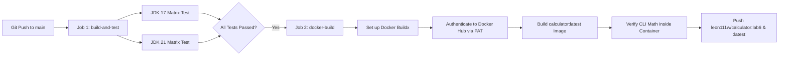

# Java CLI Calculator — Software Development Tools (Labs 3 – 6)

[English](README.md) | [中文说明](README_zh.md)

[](https://github.com/Ling-Qingyang/calculator/actions/workflows/ci-calculator.yml)
[](https://hub.docker.com/r/leon111w/calculator)
[](https://adoptium.net/)
[](target/site/jacoco/index.html)
[](LICENSE)

An enterprise-grade, containerized Java CLI Calculator application developed throughout the **Software Development Tools** course curriculum at **Waterford Institute, NUIST**. This repository showcases an end-to-end modern software engineering lifecycle: from initial modular architecture and unit testing to continuous integration (CI) and containerized continuous delivery (CD).

- **Student Author**: Ling Qingyang (ID: 202583930013)
- **Institution**: Waterford Institute, Software Engineering (Class SE 01, Grade 2025)
- **Instructor**: Prof. Yuanfang Zhang
- **Public Container Registry**: [Docker Hub - leon111w/calculator](https://hub.docker.com/r/leon111w/calculator)

---

## 1. Laboratory Evolution & Engineering Milestones

This repository represents the cumulative outcome of four progressive laboratory assignments:

| Lab Milestone | Focus Area | Key Architectural & Engineering Deliverables |
| :--- | :--- | :--- |
| **Lab 3: Core Architecture & CLI** | Java CLI Tooling | • Core arithmetic engine supporting `+`, `-`, `*`, `/`, `^`, `%`<br>• Robust defensive input sanitization and division-by-zero prevention<br>• Maven project scaffolding and Maven Shade Plugin uber-jar packaging |
| **Lab 4: Automated Testing & Coverage** | Quality Assurance | • 32 comprehensive unit test cases implemented with JUnit Jupiter 5 & AssertJ<br>• Edge cases, blank strings, non-numeric strings, and error condition coverage<br>• JaCoCo code coverage integration achieving **100% line & branch coverage** |
| **Lab 5: Continuous Integration (CI)** | Cloud CI Pipeline | • GitHub Actions automated CI workflow (`.github/workflows/ci-calculator.yml`)<br>• Test matrix validation executing concurrently across OpenJDK 17 & OpenJDK 21<br>• Maven dependency caching and dynamic status badge integration |
| **Lab 6: Containerization & Delivery (CD)** | Docker & Cloud CD | • Enterprise multi-stage `Dockerfile` (`maven:3.8-openjdk-17` → `eclipse-temurin:17-jre-alpine`)<br>• Image footprint optimization from 1.26 GB to **257 MB** (nearly 80% reduction)<br>• CI/CD pipeline extension: automated container build, verification, and push to Docker Hub |

---

## 2. Technical Stack & Environment

- **Programming Language**: Java 17 LTS (Matrix tested on Java 21 LTS)
- **Build & Packaging**: Apache Maven 3.8.8, Maven Shade Plugin 3.5.1
- **Testing & Assertions**: JUnit 5 (Jupiter 5.10.0), AssertJ 3.25.3
- **Coverage Analysis**: JaCoCo 0.8.11
- **Container Engine**: Docker Desktop 4.50.0 / Docker Engine 28.5.1
- **Base Images**: `maven:3.8-openjdk-17` (Stage 1) & `eclipse-temurin:17-jre-alpine` (Stage 2)
- **CI/CD Platform**: GitHub Actions (Ubuntu 24.04 LTS hosted runners)
- **Artifact Registry**: Docker Hub (`leon111w/calculator:lab6` and `latest`)

---

## 3. Quick Start: Docker Execution (Lab 6)

### Option A: Pull Pre-built Image from Docker Hub
```bash
# 1. Pull the official verified Lab 6 image
docker pull leon111w/calculator:lab6

# 2. Run with default fallback parameters (10 + 20)
docker run --rm leon111w/calculator:lab6

# 3. Perform arbitrary calculations
docker run --rm leon111w/calculator:lab6 15 + 27       # Addition -> 42.0
docker run --rm leon111w/calculator:lab6 100 - 35      # Subtraction -> 65.0
docker run --rm leon111w/calculator:lab6 8 "*" 9       # Multiplication -> 72.0
docker run --rm leon111w/calculator:lab6 144 / 12      # Division -> 12.0
docker run --rm leon111w/calculator:lab6 2 "^" 8       # Exponentiation -> 256.0
docker run --rm leon111w/calculator:lab6 17 "%" 5      # Modulo -> 2.0
docker run --rm leon111w/calculator:lab6 10 / 0        # Division by zero trap -> IllegalArgumentException
```

### Option B: Build and Run Locally
```bash
# 1. Build multi-stage Docker image locally
docker build -t calculator:v1 .

# 2. Inspect compact image footprint (~257 MB)
docker images | grep calculator

# 3. Execute local container
docker run --rm calculator:v1 50 / 5
```

---

## 4. Local Maven Development (Labs 3 & 4)

```bash
# 1. Clean and compile source code
mvn clean compile

# 2. Execute all 32 unit tests with JaCoCo coverage report generation
mvn test

# 3. Inspect generated JaCoCo coverage report in browser
# Report path: target/site/jacoco/index.html

# 4. Package executable shaded Fat JAR
mvn package

# 5. Run packaged JAR via local JVM
java -jar target/calculator-1.0.jar 42 "*" 2
```

---

## 5. Automated CI/CD Workflow (`.github/workflows/ci-calculator.yml`)

The repository includes a two-stage automated pipeline that executes on every push to `main` and all pull requests:



1. **Job 1 (`build-and-test`)**: Matrix validation on Ubuntu runners for JDK 17 & 21 with automatic Maven dependency caching.
2. **Job 2 (`docker-build`)**: Downstream delivery job that activates strictly when tests pass on the `main` branch:
   - Provisions Docker Buildx.
   - Securely authenticates via encrypted repository secrets (`DOCKERHUB_USERNAME`, `DOCKERHUB_TOKEN`).
   - Builds and locally evaluates container calculation sanity.
   - Tags and publishes versioned images (`:lab6` and `:latest`) to Docker Hub.

---

## 6. Project Directory Layout

```text
calculator/
├── .github/
│   └── workflows/
│       └── ci-calculator.yml         # Lab 5 & 6 Unified CI/CD Pipeline
├── src/
│   ├── main/java/com/lingqingyang/
│   │   ├── App.java                 # CLI Entrypoint & Argument Parser (Lab 3)
│   │   └── Calculator.java          # Core Arithmetic Engine (Lab 3)
│   └── test/java/com/lingqingyang/
│       ├── AppTest.java             # CLI Parameter & Exception Tests (Lab 4)
│       └── CalculatorTest.java      # Precision & Edge Case Unit Tests (Lab 4)
├── Dockerfile                        # Multi-Stage Annotated Dockerfile (Lab 6)
├── pom.xml                           # Maven POM with Aliyun Mirrors & Plugins
├── README.md                         # Full English Documentation (Labs 3-6)
├── README_zh.md                      # 中文完整项目说明 (Labs 3-6)
└── LICENSE                           # MIT License
```
