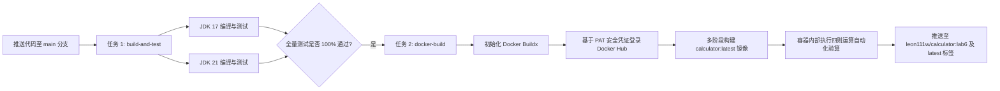

# Java 命令行计算器 — 软件开发工具实验全流程（Lab 3 – 6）

[English](README.md) | [中文说明](README_zh.md)

[](https://github.com/Ling-Qingyang/calculator/actions/workflows/ci-calculator.yml)
[](https://hub.docker.com/r/leon111w/calculator)
[](https://adoptium.net/)
[](target/site/jacoco/index.html)
[](LICENSE)

本项目为南京信息工程大学沃特福德学院 **《软件开发工具》** 实验课程全流程演进成果。项目完整覆盖了现代软件工程全生命周期：从初始命令行计算器模块化设计、全量单元测试与代码覆盖率分析，到 GitHub Actions 持续集成（CI）自动化流水线，以及最终基于 Docker 的多阶段容器化镜像构建与自动化持续交付（CD）。

- **学生姓名**：凌青洋（学号：202583930013）
- **专业班级**：软件工程 2025 级 01 班（沃特福德学院）
- **指导教师**：张远方 教授
- **Docker Hub 公共镜像仓库**：[leon111w/calculator](https://hub.docker.com/r/leon111w/calculator)

---

## 1. 实验演进与阶段里程碑（Lab 3 ~ Lab 6）

本项目记录并沉淀了四个连续实验的递进开发历程：

| 实验阶段 | 核心主题 | 关键工程交付物与技术突破 |
| :--- | :--- | :--- |
| **Lab 3：基础架构与 CLI** | 命令行开发与 Maven 构建 | • 实现高精度四则运算内核，支持加（`+`）、减（`-`）、乘（`*`）、除（`/`）、乘方（`^`）与取模（`%`）<br>• 实现完备的防御性编程：空串输入过滤、非数字格式校验与除以零严苛拦截<br>• 采用 Maven Shade Plugin 打包独立可执行的 Fat JAR，解决外部依赖隔离问题 |
| **Lab 4：自动化测试与覆盖率** | 单元测试与质量保障 | • 基于 JUnit Jupiter 5 与 AssertJ 编写 32 个严密单元测试用例<br>• 深度测试各类边界用例、浮点精度异常及非法字符输入<br>• 深度整合 JaCoCo 覆盖率检测工具，实现代码 **行覆盖率 100%、分支覆盖率 100%** |
| **Lab 5：持续集成（CI）** | GitHub Actions 云端流水线 | • 编写标准化 GitHub Actions 工作流（`.github/workflows/ci-calculator.yml`）<br>• 配置 OpenJDK 17 与 OpenJDK 21 双版本矩阵并行测试，验证跨版本兼容性<br>• 引入 Maven 依赖全局缓存与构建状态动态 Badge 徽标展示 |
| **Lab 6：容器化与持续交付（CD）** | Docker 虚拟化与自动发布 | • 采用工业界标准的多阶段构建 `Dockerfile`（编译阶段 Maven 3.8 + 运行时 Temurin Alpine JRE）<br>• 最终镜像体积从 1.26 GB 骤降至 **257 MB**（压缩率近 80%），极大节约分发带宽<br>• CI 流水线深度扩展：在测试通过后自动触发 Docker 镜像编译、容器内部验算并自动推送至 Docker Hub |

---

## 2. 技术栈与环境版本

- **开发语言**：Java 17 LTS（CI 并行验证 Java 21 LTS）
- **构建管理**：Apache Maven 3.8.8, Maven Shade Plugin 3.5.1
- **测试框架**：JUnit 5 (Jupiter 5.10.0), AssertJ 3.25.3
- **代码分析**：JaCoCo 0.8.11
- **容器引擎**：Docker Desktop 4.50.0 / Docker Engine 28.5.1
- **基础镜像**：`maven:3.8-openjdk-17`（Stage 1 编译环境）& `eclipse-temurin:17-jre-alpine`（Stage 2 轻量运行环境）
- **云端集成**：GitHub Actions（Ubuntu 24.04 LTS 托管节点）
- **公共仓库**：Docker Hub 镜像服务（标签：`leon111w/calculator:lab6` 与 `latest`）

---

## 3. 快速上手：Docker 容器运行（Lab 6）

### 方式一：直接拉取 Docker Hub 官方镜像
```bash
# 1. 从 Docker Hub 拉取经实验完整验证的 Lab 6 镜像
docker pull leon111w/calculator:lab6

# 2. 运行默认入口演示（默认执行 10 + 20）
docker run --rm leon111w/calculator:lab6

# 3. 传入自定义参数进行计算
docker run --rm leon111w/calculator:lab6 15 + 27       # 加法运算 -> 42.0
docker run --rm leon111w/calculator:lab6 100 - 35      # 减法运算 -> 65.0
docker run --rm leon111w/calculator:lab6 8 "*" 9       # 乘法运算 -> 72.0
docker run --rm leon111w/calculator:lab6 144 / 12      # 除法运算 -> 12.0
docker run --rm leon111w/calculator:lab6 2 "^" 8       # 乘方运算 -> 256.0
docker run --rm leon111w/calculator:lab6 17 "%" 5      # 取模运算 -> 2.0
docker run --rm leon111w/calculator:lab6 10 / 0        # 除以零拦截 -> 抛出 IllegalArgumentException
```

### 方式二：本地自主构建与运行
```bash
# 1. 依托多阶段 Dockerfile 构建本地镜像
docker build -t calculator:v1 .

# 2. 查看镜像信息与精简体积（~257 MB）
docker images | grep calculator

# 3. 运行本地容器化计算器
docker run --rm calculator:v1 50 / 5
```

---

## 4. 本地 Maven 开发指南（Labs 3 & 4）

```bash
# 1. 清理并编译源代码
mvn clean compile

# 2. 执行全量 32 个单元测试并导出 JaCoCo 覆盖率报表
mvn test

# 3. 浏览器查阅测试覆盖率报告
# 文件路径: target/site/jacoco/index.html

# 4. 打包生成带有所有依赖的可执行 Fat JAR
mvn package

# 5. 通过本地 JVM 直接运行
java -jar target/calculator-1.0.jar 42 "*" 2
```

---

## 5. 自动化 CI/CD 流水线架构（`.github/workflows/ci-calculator.yml`）

本项目在代码推送或合并时全自动触发云端流水线：



1. **Job 1 (`build-and-test`)**：在 Ubuntu 容器上并发进行 JDK 17 与 JDK 21 跨环境编译与 32 项自动化测试，支持 Maven 依赖层自动缓存。
2. **Job 2 (`docker-build`)**：下游自动化持续交付任务，仅在 `main` 分支测试全绿后激活：
   - 安全读取加密机密凭证（`DOCKERHUB_USERNAME` 与 `DOCKERHUB_TOKEN`）登录 Docker Hub；
   - 自动构建 Alpine 运行态轻量镜像，并在沙箱内执行真机运算测试；
   - 自动推送 `:lab6` 与 `:latest` 镜像至 Docker Hub 全球公共仓库。

---

## 6. 项目文件组织树

```text
calculator/
├── .github/
│   └── workflows/
│       └── ci-calculator.yml         # Lab 5 与 Lab 6 统一 CI/CD 流水线配置
├── src/
│   ├── main/java/com/lingqingyang/
│   │   ├── App.java                 # 命令行参数解析与入口调度（Lab 3）
│   │   └── Calculator.java          # 核心高精度算术逻辑引擎（Lab 3）
│   └── test/java/com/lingqingyang/
│       ├── AppTest.java             # 命令行调用与异常防御测试（Lab 4）
│       └── CalculatorTest.java      # 运算精度与边界用例单元测试（Lab 4）
├── Dockerfile                        # 多阶段构建生产级 Dockerfile（Lab 6）
├── pom.xml                           # 包含阿里云镜像与插件配置的 Maven POM
├── README.md                         # 英文全流程工程文档 (Labs 3-6)
├── README_zh.md                      # 中文全流程工程说明 (Labs 3-6)
└── LICENSE                           # MIT 开源许可证
```
